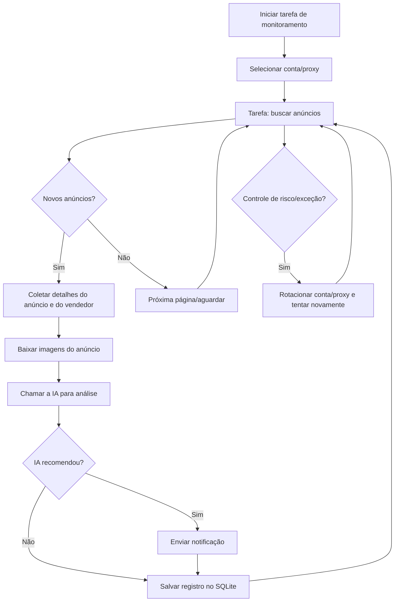

# Sistema Inteligente de Monitoramento do Xianyu (闲鱼 / Goofish)

[中文](README.md) ｜ [English](README_EN.md) ｜ [Português]

Monitoramento multitarefa em tempo real do Xianyu (闲鱼), baseado em Playwright e IA, com uma interface Web completa de gerenciamento.

## Principais recursos

- **Gerenciamento visual via Web**: tarefas, contas, edição de critérios de IA, logs de execução e navegação pelos resultados
- **Orientado por IA**: criação de tarefas em linguagem natural e análise aprofundada dos anúncios por modelo multimodal
- **Multitarefa concorrente**: palavras-chave, preços, filtros e prompts de IA configurados de forma independente
- **SQLite como armazenamento principal**: tarefas, resultados e histórico de preços ficam em um único banco embarcado, sem varrer `jsonl` repetidamente
- **Filtros avançados**: frete grátis, janela de tempo de publicação e filtro regional em três níveis (província/cidade/distrito)
- **Notificações instantâneas**: ntfy.sh, WeChat Work (企业微信), Bark, Telegram, Webhook e outros canais
- **Agendamento**: tarefas periódicas via expressões Cron
- **Rodízio de contas e proxies**: múltiplas contas, vínculo conta-tarefa, pool de proxies com rotação e nova tentativa em caso de falha
- **Implantação com Docker**: contêiner pronto com um único comando

## Capturas de tela


## 🐳 Implantação com Docker (recomendado)

```bash
git clone https://github.com/Usagi-org/ai-goofish-monitor && cd ai-goofish-monitor
cp .env.example .env
vim .env # preencha as variáveis necessárias
docker compose up -d
docker compose logs -f app
docker compose down
```

Se a imagem não puder ser acessada ou o download estiver lento, use o espelho de aceleração:

```bash
docker pull ghcr.nju.edu.cn/usagi-org/ai-goofish:latest
docker tag ghcr.nju.edu.cn/usagi-org/ai-goofish:latest ghcr.io/usagi-org/ai-goofish:latest
docker compose up -d
```

- Endereço padrão da Web UI: `http://127.0.0.1:8000`
- A imagem Docker já inclui o Chromium; não é preciso instalar navegador no host.
- Imagem oficial: `ghcr.io/usagi-org/ai-goofish:latest`
- Atualizar a imagem: `docker compose pull && docker compose up -d`
- Se alterar `SERVER_PORT` no `.env`, atualize também o mapeamento de portas em `docker-compose.yaml`.
- Por padrão, `docker-compose.yaml` monta o banco SQLite em `./data:/app/data`; o arquivo do banco é `data/app.sqlite3`
- Estes diretórios são persistidos por padrão:
    - `data/`: armazenamento principal SQLite (tarefas, resultados, histórico de preços)
    - `state/`: arquivos de cookies com o estado de login
    - `prompts/`: prompts das tarefas
    - `logs/`: logs de execução
    - `images/`: imagens dos anúncios e diretórios temporários de imagens das tarefas
    - `config.json`, `jsonl/`, `price_history/`: fontes legadas usadas para a importação única na primeira migração para SQLite

### Armazenamento e migração

- O armazenamento principal online é o SQLite, com caminho padrão `data/app.sqlite3`
- É possível personalizar o caminho com a variável `APP_DATABASE_FILE`; no Docker o padrão é `/app/data/app.sqlite3`
- Ao iniciar, a aplicação cria o banco e as tabelas automaticamente e tenta importar uma única vez os dados legados de `config.json`, `jsonl/` e `price_history/`
- `state/`, `prompts/`, `logs/` e `images/` continuam sendo diretórios do sistema de arquivos, fora do SQLite
- As imagens dos anúncios são baixadas temporariamente em `images/task_images_<nome_da_tarefa>/` e, por padrão, são limpas ao fim da tarefa
- Depois da primeira atualização, e de confirmar que os dados em `data/app.sqlite3` estão corretos, você decide se mantém os mounts legados de `config.json`, `jsonl/` e `price_history/`

### Configuração mínima

| Variável | Descrição | Obrigatória |
|----------|-----------|-------------|
| `OPENAI_API_KEY` | Chave de API do modelo de IA | Sim |
| `OPENAI_BASE_URL` | URL da API compatível com OpenAI | Sim |
| `OPENAI_MODEL_NAME` | Nome do modelo com suporte a imagens | Sim |
| `WEB_USERNAME` / `WEB_PASSWORD` | Usuário e senha da Web UI, padrão `admin/admin123` | Não |

As demais opções estão em "Configuração" mais abaixo.

### Primeiro uso

1. Abra a Web UI em `http://127.0.0.1:8000` e faça login.
2. Vá em "Gerenciamento de contas do Xianyu" e use a [extensão do Chrome](https://chromewebstore.google.com/detail/xianyu-login-state-extrac/eidlpfjiodpigmfcahkmlenhppfklcoa) para exportar e colar o JSON do estado de login do Xianyu.
3. Os arquivos de estado de login são salvos em `state/`, por exemplo `state/acc_1.json`.
4. Volte para "Gerenciamento de tarefas", crie uma tarefa, vincule uma conta e execute.

### Criando a primeira tarefa

- `Decisão por IA`: preencha a "descrição detalhada". Após enviar, abre-se um diálogo de progresso separado enquanto os critérios de análise são gerados de forma assíncrona em segundo plano.
- `Decisão por palavras-chave`: informe as regras de palavras-chave; a tarefa é criada diretamente, sem passar pela geração por IA.
- `Filtro regional`: agora é um seletor de província / cidade / distrito, com dados embutidos a partir de um snapshot da página do Xianyu.

## Guia do usuário

<details>
<summary>Clique para expandir as notas de uso da Web UI</summary>

### Gerenciamento de tarefas

- Suporta criação por IA, regras de palavras-chave, faixa de preço, filtro de tempo de publicação, filtro regional, vínculo de conta e agendamento.
- A criação de tarefas por IA roda como job em segundo plano e exibe um diálogo de progresso dedicado após o envio.
- O filtro regional reduz bastante os resultados; deixá-lo vazio é o padrão mais seguro.

### Gerenciamento de contas

- Importar, atualizar e excluir estados de login de contas do Xianyu.
- Cada tarefa pode ter uma conta específica ou deixar a escolha para o sistema.

### Resultados e logs

- A página de resultados e a exportação agora consultam o SQLite, em vez de varrer diretamente os arquivos `jsonl`.
- A página de logs mostra a execução por tarefa e ajuda a diagnosticar expiração de login, controle de risco (anti-bot) e falhas nas chamadas de IA.

### Configurações do sistema

- Permite ver o status do sistema, editar prompts e ajustar proxy e rotação.

</details>

## Guia do desenvolvedor

### Requisitos

- Python 3.10+
- Node.js + npm (o `Node v20.18.3` foi validado para concluir o build do frontend)
- Playwright CLI e Chromium. Antes da primeira execução, recomenda-se rodar `python3 -m pip install playwright && python3 -m playwright install chromium`
- Chrome ou Edge em desktop (no Linux, o Chromium também funciona). O `start.sh` verifica se há navegador antes de continuar

```bash
git clone https://github.com/Usagi-org/ai-goofish-monitor
cd ai-goofish-monitor
cp .env.example .env
```

### Inicialização com um comando

```bash
chmod +x start.sh
./start.sh
```

O `start.sh` primeiro valida o Playwright CLI e o navegador. Atendidos os pré-requisitos, instala as dependências do projeto, faz o build do frontend, copia os artefatos e inicia o backend.

### Inicialização manual

```bash
# backend
python -m src.app
# ou
uvicorn src.app:app --host 0.0.0.0 --port 8000 --reload

# frontend
cd web-ui
npm install
npm run dev
```

- Ao iniciar, o FastAPI inicializa o SQLite e, na primeira vez, tenta importar os dados legados de `config.json/jsonl/price_history`
- O `spider_v2.py` lê as tarefas do SQLite por padrão; o modo de compatibilidade com configuração JSON só é usado quando `--config <caminho>` é passado explicitamente
- O caminho padrão do banco é `data/app.sqlite3`
- O servidor de desenvolvimento do Vite faz proxy de `/api`, `/auth` e `/ws` para `http://127.0.0.1:8000`.
- `npm run build` gera `web-ui/dist/`, e o `start.sh` copia o resultado para `dist/` na raiz do repositório.
- O FastAPI serve `dist/index.html` e `dist/assets/` a partir da raiz do repositório.
- O `./start.sh` exibe a URL padrão `http://localhost:8000` e a documentação da API em `http://localhost:8000/docs`.

### Testes e validação

```bash
PYTEST_DISABLE_PLUGIN_AUTOLOAD=1 pytest
cd web-ui && npm run build
```

### API de criação de tarefas

<details>
<summary>Clique para expandir o comportamento da API</summary>

- `POST /api/tasks/generate`
  - `decision_mode=ai`: retorna `202` com um `job`; o cliente deve consultar o progresso periodicamente.
  - `decision_mode=keyword`: retorna diretamente a tarefa criada.
- `GET /api/tasks/generate-jobs/{job_id}`: consulta o progresso da geração da tarefa por IA.
- `POST /auth/status`: valida as credenciais de login da Web UI.

</details>

## Configuração

<details>
<summary>Clique para expandir as opções de configuração mais comuns</summary>

### IA e execução

- `OPENAI_API_KEY` / `OPENAI_BASE_URL` / `OPENAI_MODEL_NAME`: configurações obrigatórias do modelo de IA.
- `PROXY_URL`: proxy HTTP/SOCKS5 exclusivo para as requisições de IA.
- `RUN_HEADLESS`: define se o scraper roda em modo headless; mantenha `true` no Docker.
- `SERVER_PORT`: porta do backend, padrão `8000`.
- `LOGIN_IS_EDGE`: permite usar o Edge em vez do Chrome localmente; a imagem Docker não inclui o Edge e sempre usa o Chromium.
- `PCURL_TO_MOBILE`: converte links de anúncios de desktop para links mobile.

### Notificações

- `NTFY_TOPIC_URL`
- `GOTIFY_URL` / `GOTIFY_TOKEN`
- `BARK_URL`
- `WX_BOT_URL`
- `TELEGRAM_BOT_TOKEN` / `TELEGRAM_CHAT_ID` / `TELEGRAM_API_BASE_URL`
- `WEBHOOK_*`

### Rotação de proxy e proteção contra falhas

- `PROXY_ROTATION_ENABLED`
- `PROXY_ROTATION_MODE`
- `PROXY_POOL`
- `PROXY_ROTATION_RETRY_LIMIT`
- `PROXY_BLACKLIST_TTL`
- `TASK_FAILURE_THRESHOLD`
- `TASK_FAILURE_PAUSE_SECONDS`
- `TASK_FAILURE_GUARD_PATH`

A lista completa está em `.env.example`.

</details>

## Autenticação da Web

<details>
<summary>Clique para expandir as notas de autenticação</summary>

- A Web UI usa uma página de login e valida as credenciais via `POST /auth/status`.
- Após o login, o frontend guarda o estado de autenticação localmente no navegador, para os guards de rota e a inicialização do WebSocket.
- As credenciais padrão são `admin/admin123`; **altere-as em produção**.

</details>

## 🚀 Fluxo de trabalho

O diagrama abaixo descreve a lógica central de uma tarefa de monitoramento, do início ao fim. O serviço principal roda em `src.app` e inicia um ou mais processos de tarefa conforme ações do usuário ou o agendamento.



## Perguntas frequentes

<details>
<summary>Clique para expandir as perguntas frequentes</summary>

### Por que a criação de tarefas por IA não é imediata?

No modo IA, o sistema primeiro gera os critérios de análise e só depois cria a tarefa. Esse fluxo agora roda como job em segundo plano, com um diálogo de progresso separado, para que o formulário não fique travado por muito tempo.

### Por que se recomenda deixar o filtro regional vazio por padrão?

O filtro regional reduz bastante o volume de resultados e serve para quando você quer ver apenas uma região específica. Se quiser primeiro avaliar o mercado como um todo, deixe-o em branco.

### A página local informa que os artefatos do frontend não existem. E agora?

Isso significa que o diretório `dist/` na raiz do repositório está ausente. Execute `./start.sh` ou rode `npm run build` em `web-ui/` e confirme que os artefatos foram copiados para a raiz do repositório.

### Por que o `./start.sh` reclama da falta do Playwright ou de um navegador?

É uma verificação de pré-requisitos do script. Instale primeiro o Playwright CLI e o Chromium, garanta que haja Chrome, Edge (ou Chromium no Linux) disponível no sistema e execute `./start.sh` novamente.

</details>

## Agradecimentos

<details>
<summary>Clique para expandir os agradecimentos</summary>

Este projeto se inspirou nos seguintes projetos excelentes. Agradecimentos especiais a:

- [superboyyy/xianyu_spider](https://github.com/superboyyy/xianyu_spider)

Também agradecemos aos colaboradores do LinuxDo pelas contribuições de scripts:

- [@jooooody](https://linux.do/u/jooooody/summary)

E agradecemos à comunidade [LinuxDo](https://linux.do/).

Agradecemos ainda a ferramentas de modelos como ClaudeCode/Gemini/Codex, que liberam as mãos e permitem experimentar a alegria do Vibe Coding.

</details>

## Avisos importantes

<details>
<summary>Clique para expandir os detalhes dos avisos</summary>

- Respeite o contrato de usuário e as regras de robots.txt do Xianyu. Não faça requisições excessivamente frequentes, para não sobrecarregar o servidor nem ter a conta restringida.
- Este projeto é destinado apenas a estudo e pesquisa técnica. Não o utilize para fins ilegais.
- O projeto é distribuído sob a [Licença MIT](LICENSE), fornecido "no estado em que se encontra", sem garantias de qualquer tipo.
- Os autores e colaboradores não se responsabilizam por quaisquer danos ou perdas diretos, indiretos, incidentais ou especiais decorrentes do uso deste software.
- Para mais detalhes, consulte o arquivo de [Isenção de responsabilidade](DISCLAIMER.md).

</details>

## Star History

[](https://www.star-history.com/#Usagi-org/ai-goofish-monitor&Date)


